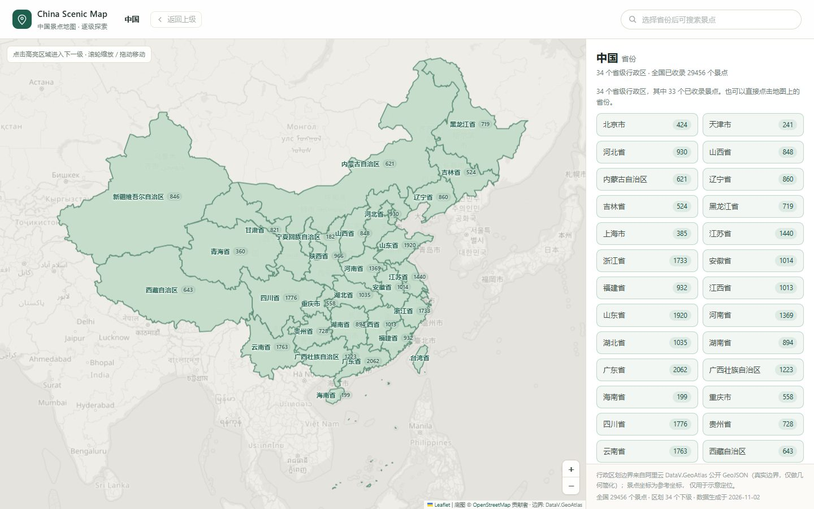
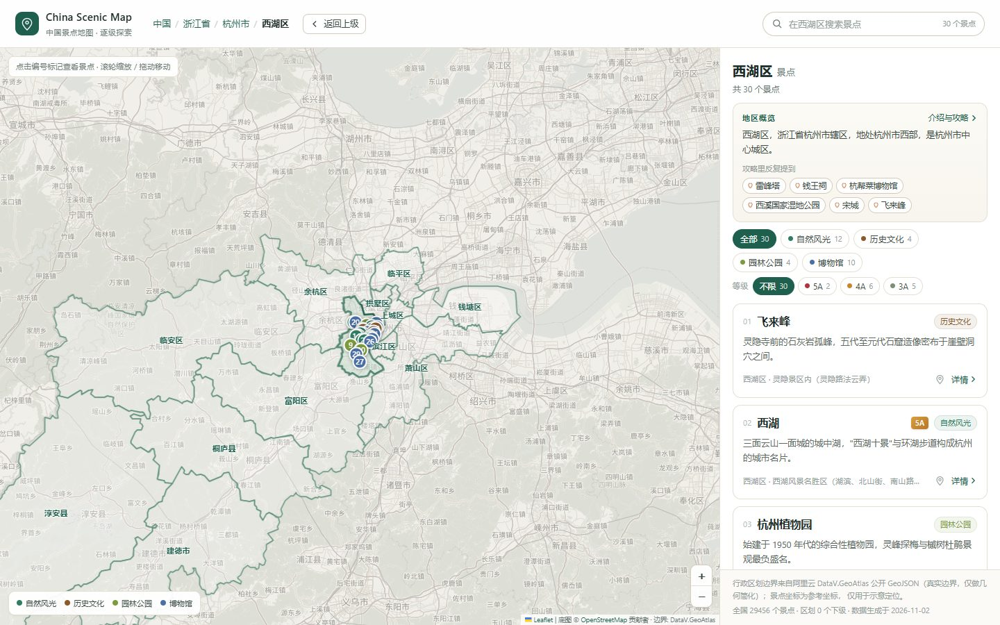
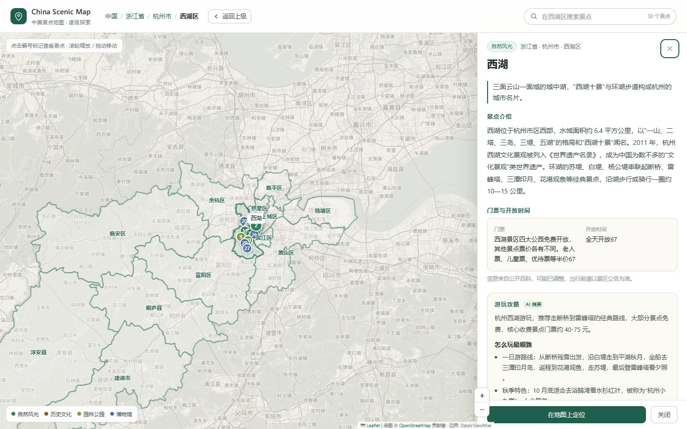

# China Scenic Map · 中国景点地图

一个可以逐级下钻的中国景点地图：**全国 → 省 → 地级市 → 区县 → 景点列表 → 景点详情**。
全部行政区划边界使用真实的公开 GeoJSON 数据，景点坐标与区划归属用真实边界做点面计算得出。

> 定位：PoC / 演示项目。地图不用于导航、测绘或任何需要审图号的场景。
>
> 关于数据：景点与地区文字来自公开渠道（文旅部门名录、OpenStreetMap、Wikidata、百科词条），
> 著作权归原平台与作者；抓取结果只在本地生成，**不随仓库分发**，仓库里不含任何抓取数据。



| 逐级下钻到区县（西湖区） | 景点详情（介绍 / 门票 / 攻略） |
| --- | --- |
|  |  |

<p align="center">
  
  <br>
  <sub>手机端：地图 / 列表切换，整列可滚动，卡片分批加载</sub>
</p>

---

## 一、已实现的功能

### 地图与下钻

- **全国 34 个省级行政区 → 363 个地级行政区 → 2837 个区县**，全部使用真实边界。
- 每一层只加载当层所需的边界文件：进入省拉 ~100KB，进入市拉 ~40KB，不加载全量数据。
- 可下钻区域绿色高亮 + 深绿描边，悬停变亮；当前区域用实色高亮，兄弟区域淡化作背景。
- 区域标签上直接显示该区域的景点数量（如「西湖区 2」），不再叠加独立气泡。
- 面包屑（中国 / 浙江省 / 杭州市 / 西湖区）与「返回上级」按钮；返回上级时刚离开的区域用橙色虚线标出。
- 在区县视图可以直接点击相邻区县切换，无需先返回市级。

### 景点列表与详情

- 只展示属于当前区域（含下级）的景点，越往下越精确。
- 名称 + 地址关键词搜索；四类筛选（自然风光 / 历史文化 / 园林公园 / 博物馆），带数量角标，再点取消。
- **A 级筛选**：5A / 4A / 3A 三档独立筛选（2A / 1A 数量少、认可度接近，合并进「不限」），同样带数量角标，与搜索、类别筛选叠加生效。
- 卡片包含：序号（与地图标记一一对应）、名称、一句话介绍、类别、区县与地址、定位按钮。
- 详情使用桌面右侧抽屉 / 移动端底部抽屉，展示省市县归属、介绍（标注出处）、门票与开放时间、游玩攻略、地址、参考坐标、数据来源与置信度标记。
- 关闭详情（Esc / 关闭按钮 / 遮罩）后，地图与列表状态完整保留。

### 联动

- 点击地图标记 → 打开对应景点详情。
- 点击列表项 → 打开详情并高亮地图标记；点击「定位」→ 飞行定位（桌面自动左偏避开抽屉）。
  **定位会先把行政区切到景点所在的最深一级**（区县优先，没有边界数据就退到市），
  否则在省级列表里点定位只会在上级边界上空放大，既没有标记、面包屑也停在原层级。
  跨层级时等新层级边界加载完再飞，避免被 `fitBounds` 拉回区域范围。
- 搜索与筛选同时作用于地图标记与列表。

### 地区介绍与攻略

- **每个行政区自己的一份资料**：省（浙江省）、市（杭州市）、区县（西湖区）都有「一句话定位 + 完整介绍 + AI 旅游攻略」，
  按 adcode 单独存一个小文件，进入哪一级才加载哪一份。
- 列表顶部固定一条「地区概览」：两行定位 + 攻略里反复被点名的景点（最多 6 个，显示攻略里的叫法而不是名录全名）。
  不展开也只占三四行，不跟景点列表抢空间。
- 想看全文点右侧「介绍与攻略」，打开与景点详情同款的抽屉：基本信息（面积 / 人口 / 气候 / 政府驻地）、
  地区介绍（标出处）、旅游攻略（分节）、**攻略推荐的景点清单**。
- 推荐景点不是另编的榜单，而是**从攻略正文里反向匹配出来的**：攻略提到「雷峰塔 8 次、西湖 5 次」，
  就按频次 + A 级加权排序，并且只保留本图已收录的景点——保证每个推荐都点得动、定得到位。
- 推荐跨层级也能定位：在浙江省概览里点「乌镇」，先切到嘉兴市 / 桐乡市、再飞到乌镇并高亮，面包屑同步到区县。
  复用景点定位那套逻辑，不额外造一套跳转。
- 抓到的攻略卡太残或干脆没有的几个市（海口、凉山、黔东南、黄南），攻略由模型补写，
  徽标标「AI 整理」、脚注写明是「没有摘要」还是「摘要太少」，不和搜来的混为一谈。

### 工程与体验

- Hash 路由 `#/330000/330100/330106?poi=west-lake`：刷新、深链接、前进后退都能还原。
- 边界按视图懒加载并缓存；加载中、加载失败可重试、底图不可用时自动降级为"仅边界模式"。
- **底图随缩放让位**：全国 / 省级视图把 OSM 底图去饱和、压淡成"纸感"背景，让行政区划色块成为主体；
  放大到市 / 区县后底图连续恢复为接近原色的清晰样式，街道、巷名、水域可正常辨认（用 CSS 变量插值，缩放时不跳档）。
- 桌面 / 平板 / 手机三档布局；移动端地图与列表可切换。
- **手机端整列可滑**：列表侧栏在窄屏下本身就是滚动容器（标题、概览、筛选、卡片一起滚），
  手指落在屏幕任意位置都能上下滑，不会出现"上半屏怎么划都没反应"。
- **列表分批渲染**：一屏只铺 60 张卡片，滑到底自动接着加载（也可点「加载更多」），
  底部常驻「已显示 N / 总数」；浙江省 1,733 个景点从一次性 2.9 万个 DOM 节点降到 1,600 个左右，
  滚动不再卡顿。滚过一屏后右下角出现「顶部」，一键回第一屏。
- 空状态区分「该区域暂无收录」与「筛选无结果」两种情况。

---

## 二、运行

```bash
npm install

npm run dev        # 开发服务器 http://127.0.0.1:5173
npm run build      # 类型检查 + 生产构建
npm run preview    # 预览生产构建
npm run typecheck  # 只做类型检查

npm run smoke      # Playwright 交互测试（100 项断言，需先启动 dev）
```

> **本仓库不含生成数据。** `public/geo/`（行政区划边界，约 11MB）与 `public/data/`（景点 / 地区资料，约 56MB）
> 是构建产物，另有 `data-src/` 下的抓取原始数据（约 60MB），都按体积原因排除在仓库外（见 `.gitignore`）。
> clone 下来 `npm install && npm run dev` 能启动，但地图与列表是空的——要看到内容，需要先按下面的命令生成数据，
> 或从本地备份把 `public/` 与 `data-src/` 拷回来。

数据生成：

```bash
npm run geo:build   # 从 DataV.GeoAtlas 拉取全国边界并简化 → public/geo/
npm run data:build  # 从 Wikidata + 人工名录生成景点数据 → public/data/attractions/

# 地区（省 / 市 / 区县）介绍与攻略
npm run data:region -- --levels=province,city          # 抓介绍 + 攻略（百科接口 + 百度 AI 卡）
npm run data:intro                                     # 补全介绍（接口只给 400 字，取词条页完整摘要）
npm run data:region:build                              # 生成 public/data/regions/{adcode}.json
```

> `geo:build` 会对 `geo.datav.aliyun.com` 发起约 400 次请求。该服务有频率限制
> （返回 `403 denied by rate limit`），脚本内置全局熔断与指数退避，但首次运行建议留出 5–10 分钟。
> 原始文件缓存在 `tmpdata/cn/`，中断后重跑只会补缺失的部分。

---

## 三、技术选型

| 选择 | 原因 |
| --- | --- |
| React 18 + TypeScript + Vite | 多层区域状态 + 地图/列表/详情三处联动，组件化收益明显；Vite 冷启动快 |
| Leaflet 1.9（命令式，不用 react-leaflet） | MIT、无需 API Key；GeoJSON 多边形 + Marker + fitBounds 恰好覆盖下钻需求，体积远小于 MapLibre |
| 不用 ECharts 地图 | 连续下钻要反复销毁重建实例，标记联动与缩放手感都不如 Leaflet |
| 边界用静态 GeoJSON，按视图拆分 | 低频数据可强缓存；每个视图只请求一个文件，避免全量 12MB 阻塞首屏 |
| 景点数据按省拆分 | 全国 2465 条，整包约 1.4MB；按省加载后进入任意区域只需一次请求 |
| 底图 OSM 瓦片 + CSS 去饱和 | 完全免费、无需 Key；去饱和后不与行政区划抢视觉。CARTO 已改为强制 Key，故弃用 |

---

## 四、数据来源与真实性

### 1. 行政区划边界（真实数据）

- 来源：**阿里云 DataV.GeoAtlas** 公开 GeoJSON，`https://geo.datav.aliyun.com/areas_v3/bound/{adcode}_full.json`
- 覆盖：34 省级 / 363 地级 / 2837 区县，共 3235 个节点，363 个边界文件（12MB）
- 处理：只做 Douglas-Peucker 几何简化与坐标保留 4 位小数，**未改动任何形状**，不做手工描边
- 层级判定以数据源自带的 `level` 字段为准，因此直辖市下辖区（北京/上海/天津/重庆）与省直辖县级行政单位（如济源、仙桃、儋州）都能正确落在对应层级

### 2. 景点数据

| 来源 | 数量 | 说明 |
| --- | --- | --- |
| 省级 A 级景区名录 | **16,042 条** | 31 个省级文旅部门发布的《XX省A级旅游景区名录表》，含官方等级与所在市/区县 |
| OpenStreetMap（ODbL） | 17,677 条 | 从 Geofabrik 全量 PBF 提取的 `tourism=attraction/museum/gallery/zoo/theme_park/aquarium` POI |
| Wikidata（CC0） | 2,650 条 | 有中文维基条目的景点实体，含 P625 坐标 |
| 人工核对名录 | 6 条 | 杭州市西湖区 6 个景点，含人工撰写的介绍 |

当前规模：**29,456 个景点，覆盖 33 个省 / 2,719 个区县**（全国 2,837 个区县，覆盖率 96%），
其中 **16,115 个带国家 A 级景区等级**（5A 374 / 4A 5,099 / 3A 9,006 / 2A 1,578 / 1A 58）。
另有 248 个市级节点上只有「名录只标到市」的点位，放大到市级才会看到。

#### 2.1 A 级景区名录是怎么来的

各省文旅厅会在「政务公开 / 通知公告」或「公共服务 → 名录查询」栏目发布《XX省A级旅游景区名录表（截至YYYY年底）》。
这是目前唯一免费的、带官方等级的完整名册。已接入 **大陆全部 31 个省级行政区、35 个来源**
（上海按等级分 3 页、新疆按等级分 3 份表、青海拆 5 页续表），
原始记录 16,044 条（同省内同名同区县合并后入库 16,042），其中 12,621 条（78.7%）能精确落到区县，其余只能落到地级市。

发布形式有六种，每种都要单独适配：

| 形式 | 来源数 | 省级单位 | 处理方式 |
| --- | ---: | --- | --- |
| xlsx 附件 | 14 | 福建 山东 河北 浙江 河南 黑龙江 安徽 新疆 辽宁 江西 陕西 广东 | 逐 sheet 解析，表头按关键词归一（`县（市）区`、`地  区`、`所在地` 等写法都要去标点后比对） |
| 网页表格 | 12 | 四川 贵州 宁夏 甘肃 天津 吉林 海南 重庆 上海 西藏 | 抓 HTML 后按 `<table>` 逐行解析 |
| PDF 附件 | 3 | 山西 内蒙古 云南 | pdfplumber 抽表（`vertical_strategy: lines`），再按「太原市：34家」这类分组行切换城市 |
| doc 附件 | 1 | 湖南 | word-extractor 取正文，按制表符切列；合并单元格会把「景区名+所在地」粘成一格，靠尾部城市名反拆 |
| 前端查询页 | 4 | 湖北 广西（DataTables 分页）、北京（Element UI 分页）、江苏（自定义翻页） | Playwright 真实内核逐页点击后合并，江苏的结果另存为行数组快照 |
| 统计年鉴表格 | 1 | 青海 | 省文旅厅的名录页是 Vue SPA、抓不到，改用《青海统计年鉴》19-9 表：等级靠「5A级景区」分组标题行切换，另带地址列，拆 5 页续表 |

各省名录的完整度与落界精度：

| 省级单位 | 条数 | 精确到区县 | 省级单位 | 条数 | 精确到区县 |
| --- | ---: | ---: | --- | ---: | ---: |
| 山东省 | 1,271 | 90% | 湖南省 | 513 | 83% |
| 四川省 | 987 | 99% | 新疆维吾尔自治区 | 503 | 94% |
| 浙江省 | 940 | 97% | 江苏省 | 453 | 41% |
| 河南省 | 859 | 35% | 山西省 | 452 | 98% |
| 广东省 | 752 | 33% | 黑龙江省 | 438 | 79% |
| 湖北省 | 709 | 84% | 内蒙古自治区 | 437 | 28% |
| 广西壮族自治区 | 699 | 100% | 重庆市 | 329 | 95% |
| 安徽省 | 688 | 98% | 吉林省 | 309 | 92% |
| 云南省 | 671 | 52% | 西藏自治区 | 209 | 27% |
| 陕西省 | 624 | 95% | 北京市 | 197 | 100% |
| 辽宁省 | 606 | 54% | 青海省 | 189 | 93% |
| 甘肃省 | 556 | 90% | 上海市 | 145 | 99% |
| 福建省 | 549 | 98% | 宁夏回族自治区 | 139 | 27% |
| 河北省 | 548 | 95% | 天津市 | 106 | 100% |
| 江西省 | 543 | 83% | 海南省 | 91 | 25% |
| 贵州省 | 532 | 88% | | | |

比例低的省不是解析失败，而是**名录本身只有「市」一列**（广东、内蒙古、宁夏、海南、江苏、西藏都是这样），
景区名里也没带区县（「广州市长隆旅游度假区」「布达拉宫」「中国煤炭博物馆」），此时只能落到市级，不猜。
反过来，广西、北京、天津三地的名录带完整区县列，所以是 100%。

抓取工具链（都在 `tools/` 下，可单独复用）：

```
tools/probe-page.mjs              单页体检：--net 抓 XHR、--click 点分页、--text 看渲染文本
tools/inspect-file.mjs            下载附件 → magic number 判类型 → 试解析 → 报条数和表头，用来快速筛掉非名录文件
tools/grab-datatable.mjs          分页表格抓取（DataTables / Element UI / 自定义翻页）
tools/lib/parse-a-list.mjs        表头定位 + 行解析，xlsx / HTML / doc / 年鉴分组表共用
tools/lib/parse-pdf-list.mjs      PDF 表格 → 记录（按「XX市：N家」分组行切换城市）
（年鉴类表格用 parse-a-list.mjs 里的 parseGroupedTable，等级靠「5A级景区」分组行切换）
tools/lib/admin-match.mjs         地名 → adcode，含民族自治州简称、县级市当城市列、景区名前缀推区县、地址里捞区县
tools/fetch-provincial-a-level.mjs 按 sources.json 抓取并落界
tools/build-attractions.mjs       合并进景点库（补等级 / 新增点位 / 三层去重）
tools/fetch-baike.mjs             按名录名查百科摘要（--levels / --retry）
tools/fetch-baike-items.mjs       按地图显示名、全部点位查百科摘要（--levels=all）
tools/fetch-guides.mjs            抓百度 AI 游玩攻略（单标签页，Playwright）
```

原始来源与抓取结果记录在 `data-src/a-level/sources.json`、`data-src/a-level/provincial.json`。

#### 2.2 名录没有坐标，怎么上图

省级名录只给了「景区名称 + 所在市 + 所在区县 + 等级」，没有经纬度。处理方式是分层的：

1. 在名录点位 400 米内找名称相似的已有 OSM 点位 —— 匹配上就只补等级，坐标不动（本轮 1,314 个）；
   距离近不代表同一处（一个 5A 景区内部散落着「太和宫」「秘云洞」这类子景点），所以必须同时要求名称相似，
   否则 5A 会被贴到子景点身上；
2. 匹配不上的新建点位，坐标落在**所在区县的代表点**（区县边界包围盒中心，按名字做确定性微偏移避免重叠），
   并在 `coordSource` 里写明「省级名录未提供坐标，此处为所在区县示意位置」（本轮 14,724 个）；
3. 名录只标到「市辖区」时，扩大到同市范围找同名点位，且要求最优候选人唯一，否则宁可不猜；
4. 同一区县里「太姥山」和「宁德市福鼎太姥山风景区」这种简称/全称指的是同一处，
   归一后名称仍不相等。只在「一方是官方名录、另一方是 OSM/Wikidata」且短名 ≥ 3 字时合并（201 个），
   合并后保留名录的正式名称与等级，但把 OSM 的实测坐标接过来，免得知名景区反而退回区县示意位置。

也就是说：**等级是官方数据，位置是示意位置**，两者在详情页分开标注，不混淆。
例外是第 4 条合并后的点位：名称与等级来自官方名录，坐标来自 OSM 实测。

#### 2.3 景点介绍、门票与游玩攻略

名录只给「名称 + 等级 + 所在地」，没有一句话介绍。自动导入的 OSM 点位原来统一显示
「该景点由 OpenStreetMap 自动导入，暂无经过核实的文字介绍」，知名景点尤其 5A 这样显示明显不合格。
于是从公开页面补了三类内容，与名录数据**分开存放**（`data-src/enrich/`），构建时再合流：

| 内容 | 来源 | 采集方式 | 存放 |
| --- | --- | --- | --- |
| 介绍（150–400 字摘要） | 百度百科词条 | 开放接口 `BaikeLemmaCardApi`（无需登录），按名录名、地图显示名、全部点位各查一轮 | `enrich/baike.json`、`enrich/baike-items.json` |
| 门票 / 开放时间 / 建议游玩 | 百科词条信息卡 | 同上，取 `card[]` 里的对应字段 | 同上 |
| 游玩攻略（分节） | 百度搜索结果页 AI 卡片 | Playwright 真内核，轮询等流式渲染 | `enrich/guides.json` |

四条采集规则，都是踩过坑才定下来的：

1. **同名词条必须校验地点**。百科里「西湖」有杭州的湖、惠州的湖、还有村镇。只要求摘要里出现区县名是不够的——
   「普陀」既可以是浙江舟山普陀区，也可以是辽宁锦州北普陀山，会把攻略贴到千里之外的景区上。
   现在的判定是：命中市名，或「省 + 区县」同时命中；`--revalidate` 会用已存摘要重算一遍，把错配降级。
2. **候选词条名要逐层剥**。名录名常写成「浙江省温州市乐清市雁荡山景区」，得先剥行政区链、再景区后缀
   （`华清宫文化旅游景区` 要整段剥掉 `文化旅游景区`，只剥 `旅游景区` 会剩「华清宫文化」查不到），
   最后还要处理名字里内嵌的地名（`迪庆香格里拉普达措`）。
3. **攻略卡片要按真实 DOM 取**。结果页里 `.cosc-card` 有好几个（「相关搜索」也是这个壳），
   要取正文最长的那个；小节在折叠面板里，视频推荐块和末尾那句 AI 反问要剔掉；
   卡片是 5–9 秒后才流式渲染出来的，等太短会误判成「没有攻略」。
   问法也影响命中率：`三坊七巷游玩攻略` 有卡，`三坊七巷历史文化街区景区游玩攻略` 就没有。
   名字的三种形态要各试一遍——括号里的别称（`明故城（三孔）旅游区` 好搜的是「三孔」）、
   `·` 拼起来的组合景区（`大雁塔·大唐芙蓉园景区` 整串没卡，拆开就有）、
   剥后缀后留下的悬空词（`西溪国家湿地公园` 剥成「西溪国家」，得再剥掉「国家」才搜得到）。
4. **同名词条要加类型后缀再试一轮**。百科接口只认词条全名，不做搜索：查「雁门关」返回的是**豫剧剧目**，
   真正的关隘词条叫「雁门关长城」。所以第一轮候选全失败、且至少见到过词条（或本身就是 A 级景区）时，
   会补 36 个类型后缀（长城 / 古城 / 古镇 / 山 / 湖 / 寺 / 宫 / 博物馆 / 国家森林公园…）再查一遍；
   纯小地名不展开，避免几百条白跑。

**采集约束**：这些请求都是低频、串行、可中断的——脚本支持 `--tabs=1`、`--batch`、`--rest`、`--minutes`
与断点续跑（按 adcode / 景点 id 跳过已有结果），跑一段时间就停下来，不开多标签页并发。

抓到的文字只落在本地 `data-src/enrich/`（不入库、不随仓库分发），仅用于本项目的演示与个人学习；
百科摘要、门票与攻略的著作权归原平台与作者，想转载或商用请自行取得授权。

构建时按「省 + 归一化名称」匹配（去括号、去景区后缀、去分隔符；命中不到再退到别名索引：
剥行政区前缀 / 拆 `·－` / **剥「公园」「博物馆」这类通用尾缀**，因为名录写「天坛公园」而点位叫「天坛」；
攻略还会把抓取时用的搜索词（`天坛公园游玩攻略`）一并当别名）。
匹配上就写入 `description` + `introSource`，用摘要首句改写「国家4A级旅游景区，位于XX」这类模板简介，
并补 `ticket / openingHours / bestSeason` 与 `guide`。

当前补充结果（`npm run data:build` 会打印同一组数字，2026-10-30 快照）：

| 等级 | 景点数 | 有介绍 | 占比 | 有门票/开放时间 | 有游玩攻略 |
| --- | ---: | ---: | ---: | ---: | ---: |
| 5A | 374 | **362** | **97%** | 312 | **373** |
| 4A | 5,099 | 3,714 | 73% | 2,632 | 4,287 |
| 3A | 9,006 | 3,910 | 43% | 2,040 | 8 |
| 2A | 1,578 | 596 | 38% | 306 | 2 |
| 1A | 58 | 16 | 28% | 7 | — |
| 无等级（OSM 自动导入） | 13,341 | 3,715 | 28% | 1,958 | 106 |
| **合计** | **29,456** | **12,313** | **41.8%** | **7,255** | **4,776** |

几点说明：

- **5A 介绍还差 12 个，都不是「漏抓」**：`八达岭长城荣誉墙`、`天津古文化街旅游区南门`、`山西省 / 地市`、`那拉提养蜂女`
  这类本身不是独立景区（OSM 里的子点位或名录里的表头行）；`法门文化景区` 的正确词条叫「法门寺」，
  这类靠机器猜不准，宁可不填。
- **无等级点位有 28% 拿到介绍**：这一轮把 OSM 自动导入的点位也全量查了一遍（14,385 条查不到、
  2,654 条是同名异地被地点校验拦下），所以从原来的 1% 涨到 28%。剩下的多是桥、观景台、小庙这类百科没有词条的地物，
  详情页仍提示「暂无经过核实的文字介绍」，不编造。
- **攻略 5A 已到 99.7%（373/374）、4A 到 84%**：唯一缺的 `淮安市周恩来故里旅游景区` 试了三种叫法
  （景区名 / 加城市名 / 周恩来纪念馆），百度都不生成 AI 攻略卡，属于确实没有。
  抓不到的景区详情页就不显示攻略区块，不留占位。
- **攻略队列要跑两个数据源**：省级名录只有 4,498 条，而地图上的 4A/5A 有 5,473 个——
  差集是 Wikidata / OSM 点位被名录等级合并进来的（北海公园、孔庙和国子监博物馆、北京动物园…）。
  只跑默认源会漏掉这批，必须再跑一轮 `--source=items`（读构建产物、跳过已有攻略的）。
  两个源都跑完后，4A 覆盖率从 80% 提到 84%。

#### 2.4 地区（省 / 市 / 区县）的介绍与旅游攻略

景点之外，每个行政区也有一份自己的资料：先看「杭州市有什么」，再决定点哪个景点。
内容和景点链路分开存（`enrich/regions.json`，键是 adcode），构建时按地区切成小文件。

| 内容 | 来源 | 采集方式 | 存放 |
| --- | --- | --- | --- |
| 地区介绍 + 一句话定位 | 百度百科词条（「浙江省」「杭州市」「西湖区」） | 接口 `BaikeLemmaCardApi` 只给 400 字摘要，再用 Playwright 取词条页 `.J-summary` 补全 | `enrich/regions.json`（`abstract` + `introFull`） |
| 地区旅游攻略（分节） | 百度搜索结果页 AI 卡片（「杭州旅游攻略」） | Playwright，与景点攻略同一套取卡与限流 | 同上 |
| 攻略推荐景点 | **不额外抓**：拿攻略正文与本地景点库做匹配 | 构建期 `build-regions.mjs` | `public/data/regions/{adcode}.json` |

三条规则：

1. **同名区县必须靠父级校验**。全国有 4 个「西湖区」（杭州 / 南昌 / 常德 / 怀化）、好几个「朝阳区」「市中区」，
   词条候选按「西湖区 → 杭州西湖区 → 浙江西湖区」依次试，摘要里必须命中**市名**（省级只校验省名），
   对不上就记 `mismatch`、不产出文件——宁可这一级没有概览卡，也不能把南昌的介绍贴到杭州头上。
   注意这个接口是**精确查表不是搜索**：传「临沂河东区」查不到，要传「临沂**市**河东区」才命中
   （重名区县的义项挂在带市名的别名上），所以市名要同时给出带「市」字和剥后缀两种写法。
2. **推荐景点只保留已收录的**。攻略里出现的名字要和景点库对上才算推荐：先把景点名剥成口语名
   （全名 / 去行政区前缀 / 去景区后缀 / 括号别称 / `·` 拆段），长名优先登记、命中后从文本里抹掉，
   避免「灵隐」抢走「灵隐寺」的次数；命中处紧跟「区 / 县 / 市 / 镇 / 路」时不算（「西湖区」不是景点「西湖」）。
   剥离出来的别名如果等于行政区短名就直接丢弃——否则「中国（杭州）人工智能小镇」会把「杭州」当成景点，
   每个市都会推荐一个叫「杭州」的地方。
3. **介绍和攻略分开判定**。没抓到介绍的地区不排进攻略队列：地区攻略的问法太泛（「朝阳区旅游攻略」），
   没有行政区身份校验，很容易拿到隔壁同名地区的攻略。
4. **百科没有独立词条的，由模型补写介绍**。全国 21 个重名小市辖区（四平铁西区、辽源龙山区、鹤岗南山区、
   南昌西湖区、乐山市中区、焦作解放区、包头青山区…）在百科里只有同名大区的义项，接口按语义就不该返回。
   这类写进 `enrich/regions-ai.json` 的 `info` 段，只写**位置、沿革、地形、主要看点**这类可靠的定性内容，
   不写面积、人口、票价等易错数字；界面上标明「模型整理：该地百科无独立词条」，与百科原文区分开。
5. **区县攻略按「是否重名」决定问法**。这条是踩出来的：第一版对所有区县都问「西湖区旅游攻略」，
   结果南昌西湖区拿到的攻略 988 字、和杭州西湖**一模一样**——泛问法只会给最出名的那一个。
   现在同名区县（全国 68 组）只问 `市名+区名`（「广州白云区旅游攻略」），不重名的先泛问、失败再退到带市名。
   拿到卡还要过身份校验：**不重名的正文提到自己就算过，重名的必须命中市名**（平遥县讲「平遥古城」不会写「晋中」，
   一开始要求市名把平遥、涞水、江宁、格尔木全误杀了）。串味的记 `offtopic` 空着，讲错城市比没有更糟。
6. **有时答的不是「有什么好玩的」，而是「怎么过去」**。整张卡是过路费、耗时、高速编号，
   一个景点都没有——「XX 旅游攻略」被理解成了两地之间的行程规划，实测 89 个区县中招。这类卡比没有更糟，
   用户点开只看得到「全程约 1638 公里，耗时 17.2 小时」。判据是**开头 12 字**加节数 ≤3：
   `交通指南 | 交通与行程 | 总里程 | 从…出发 | 距离较远`。注意卡片开头常带 🚗🗺️ emoji，
   用 `^交通` 锚定会全部漏掉；也不能拿「过路费/公里」做全文匹配——正常攻略也会写「距县城 15 公里」。
7. **「旅游攻略」这个问法本身有召回缺口**。最后 56 个区县怎么换城市问法都不出卡，一度以为是「太冷门、
   没得玩」。实际换成**人话问法**几乎全中：「XX有什么好玩的地方」6/6、「XX值得去的景点」5/6、
   「XX一日游」4/6——连革吉县、仁布县这种真冷门的县都有 700–870 字。百度把「攻略」理解成了行程规划。
   这三个问法现在是兜底，排在所有「旅游攻略」变体之后才试，避免正常地区多花时间。
8. **港澳的景点名是繁体，攻略正文是简体**。「澳門威尼斯人 The Venetian Macau」和「澳门威尼斯人」
   在字符串上毫无交集，路凼填海区 17 个度假村的推荐数是 0。别名生成里补了一步：先剥掉非中文字符，
   再按一张只覆盖景点名常用字的繁简表转写。没引 opencc（依赖太重），漏字再补。
9. **有些卡根本没有分节**。整个回答是一段 500 字左右的 intro，用 emoji 当小标题
   （衢江区：「🏞️ 想看山水瀑布，去这些地方 药王山景区：…」），`sections` 是空的，会被当成「没有攻略」。
   构建期按 emoji 断成小节、段首到第一个标点作标题，切出两节以上才采用；开头那段没有 emoji 的总述保留为 intro。
10. **同名的不一定是同一个东西**。攀枝花东区抓到的百科摘要，是一个网名「攀枝花东区」的抖音博主简介——
    身份校验只看「摘要里有没有命中市名」，而这条恰好写着「四川攀枝花东区人」，校验放行。
    这类在 `regions-ai.json` 里写 `info.override = true` 强制用模型版覆盖，并在 `note` 里记下原因。


当前覆盖（2026-11-03）：

| 层级 | 数量 | 有介绍 | 有地区攻略 |
| --- | ---: | ---: | ---: |
| 省 / 自治区 / 直辖市 / 特区 | 34 | 34 | **34** |
| 地级行政区 | 363 | 363 | **363**（359 抓取 + 4 模型整理） |
| 区县 | 2,837 | **2,837**（2,816 百科 + 21 模型整理） | **2,837（100%）** |

- **三级全部全覆盖**：3,234 个地区，介绍与攻略都没有缺口；全站 **10,809** 个推荐景点，平均每地区 3.3 个。
- **介绍**：行政区词条本身规范，第一轮 3,101/3,234。剩下的分两种：104 个是抓取时段接口连续返回空值
  被记成 `notfound`（山西 + 内蒙古 41 个、辽宁 + 吉林 25 个、川西 + 贵州 55 个，adcode 上是规整的连续块），
  重跑即命中；最后 21 个才是真没有百科词条的重名小市辖区，由模型补写（见第 4 条规则）。
  补跑命令：`npm run data:region -- --levels=district --retry=notfound,mismatch --info-only`。
- **区县攻略**：2,781 条靠「旅游攻略」系列问法，55 条靠第 7 条的人话问法救回（含平坝、嵩明、永平、革吉、
  和静、沙田），最后 6 条（长春朝阳区、南通通州区、开封鼓楼区、攀枝花东区、海西州直辖、澳门路凼填海区）
  百度所有问法都不出卡，按站内景点库与地理通识撰写，徽标「AI 整理」。中位 619 字。
- **市级攻略**：359 个市用抓到的 AI 卡，4 个（海口、凉山、黔东南、黄南）用模型补写的版本（见 2.5）。
- 区县这一层有 2,837 个，抓取按小批次推进（跑一段就停、下次接着跑），全程单页串行，不追求速度。
- 脚本支持**断点续跑**（按 adcode 跳过已有结果，`--retry` 只清指定状态那一段）。市级和区县都按
  「已收录景点数」从多到少排队，所以中断过几次也不会把时间浪费在没人看的地方：

  ```bash
  npm run data:region -- --levels=province,city --tabs=1
  npm run data:region -- --levels=district --tabs=1 --minutes=110 --batch=120 --rest=8
  ```

- **抓不到的降级路径还在，但现在用不上**：概览卡 = 一句话定位 + 百科「著名景点」里能对上的景点
  （杭州 8 个、宁波 12 个），少了攻略小节和「攻略提到几次」的标注。它不是占位填充——点得动、能定位，
  只是没有「怎么玩」的叙述。2,837 个区县补齐后，这条路径不再触发，留着是因为换数据源/换地区时还会用到。
- **最后一层兜底的写法**（6 个区县）：只写站内已收录的景点（等级与位置来自 A 级名录 / OSM，点得动）
  加上地理气候这类长期稳定的常识；不写门票价格、班次时刻、营业时间，也不替景区下「值得去」的结论。
- **介绍长度由数据源决定，不是界面截的**。`BaikeLemmaCardApi` 返回的 `abstract` 有约 **400 字硬上限**，
  超出部分直接被切掉，并以 `...` 收尾——3,234 个地区里有 **2,344 个**都断在半句
  （河北省那条断在「明称...」，后面「清改为直隶省，1928 年改名河北省」全丢了）。
  这个上限调参数没用：`bk_length` 从 1500 调到 3000，返回长度一模一样。
- **补全办法**（`npm run data:intro`）：同一个词条的**网页摘要段**是完整的。用无头浏览器打开
  `baike.baidu.com/item/<词条名>`，取 `.J-summary` 下的几段 `.summary`，去掉 `[12]` 这类引用角标后拼接，
  一般 400–900 字，是读得通的一段话。结果落 `regions.json` 的 `introFull`，原 `abstract` 原样保留，
  构建期优先用 `introFull`、没有才退回 `abstract`，随时能回滚。
  2,344 条一次跑完，0 失败。
- **两个必须处理的分支**：
  1. **多义词**。`唐山市`、`邢台市`、`承德市` 这些「XX市」在百科是多义词（地名 / 歌名 / 人名），
     直接打开只给一个「请选择义项」的空壳页（body 500 字、没有 `.J-summary`），第一批就是这样失败了 30%。
     义项链接形如 `/item/唐山市/8404217?fromModule=disambiguation`，链接文字是义项描述
     （「河北省辖地级市」/「焦立松2025年演唱歌曲」），按省名 + 行政区词打分挑，命中率 100%。
  2. **等不到 `.J-summary` 别死等**。多义词页永远不会出现那个选择器，`waitForSelector` 只会一直等到超时；
     改成等「摘要 or 多义词提示」哪个先出现（`waitForFunction`），正常页不到 1 秒就返回。
- **判据用「是否完整收尾」，不是比长度**。有 42 条网页摘要比接口那段还短几十字——因为接口是把摘要
  硬切到 400 字，切进了下一段的开头；短的那份反而是完整的话。所以只看结尾有没有 `...`，
  不看谁更长，否则这 42 条会被误判成「还没补」。
- 补全后：**3,234 / 3,234 全部有介绍，0 条以 `...` 结尾**，中位 472 字（原 403）、90% 分位 626 字、最长 871 字。
- 抽屉里的「地区介绍」原样全文显示，一个字不删；攻略按小节全文列出，也不截。
  顶部那句「一句话定位」取的就是摘要第一句，和介绍正文开头完全重复，重复时只留正文那份。
  唯一有省略号的地方是列表顶部的概览条——那句定位要跟景点列表抢纵向空间，默认折三行，
  真放不下才在下面出「展开全文」，点一下原地展开，不用为了看半句话去开抽屉。

#### 2.5 抓得不好的那几个市，由模型补写

一度有 6 个市（海口、凉山、黔东南、黔南、大理、黄南）拿不到攻略。排查后发现**主要是问法写错了**：
`short()` 只剥一层行政区后缀，`黔东南苗族侗族自治州` 变成「黔东南苗族侗族」，搜索词就成了
「黔东南苗族侗族旅游攻略」。改成连着剥民族名之后，这 6 个里有 5 个都能搜到卡。

但「能搜到」不等于「能用」：其中 3 个卡只有 2–3 节、300–660 字（凉山 3 节 321 字、黄南 2 节 663 字），
基本是「一句话路线 + 三条美食」。于是按质量取舍：

| 情况 | 用什么 | 例 |
| --- | --- | --- |
| 卡有 4 节以上且 ≥600 字 | 用抓到的（带实时票价、路线、避坑） | 大理（6 节 1,175 字）、黔南（6 节 829 字） |
| 卡太残，但有整理版 | 用整理版，徽标「AI 整理」，脚注写明「现成摘要内容太少」 | 凉山、黔东南、黄南 |
| 完全没有卡 | 用整理版，脚注写明「没有现成的攻略摘要」 | 海口 |

整理版的存放与边界：

| 维度 | 做法 |
| --- | --- |
| 存放 | `data-src/enrich/regions-ai.json`，单独一个文件，**不写进 `regions.json`** |
| 为什么分开 | 抓取脚本读不到它，`--retry` / `--fresh-profile` 重跑不会把整理内容当缓存清掉 |
| 优先级 | 好卡 > 整理版 > 残卡。判据写在构建脚本里（`searchUsable`），不是人工挑的 |
| 界面 | 徽标「AI 整理」而不是「AI 摘要」，脚注按 `reason`（none / thin）分别说明 |
| 写作边界 | 只写能核实的通识：季节与气候、交通方式、代表性景点的位置关系、民俗节期；不写具体票价、班次和营业时间 |
| 与景点库的关系 | 点名的景点尽量用库里收录的名字，这样推荐列表点得动；库里没有的名胜（如黄南的坎布拉）照样写，但不进推荐 |

这一层是**兜底而不是替代**：内容更完整的那份胜出，来源在界面上始终标清楚，不混为一谈。

顺带修了两处匹配规则，影响的是全部地区（当时推荐总数 5,823 → 6,156；三级攻略补齐后全站 **10,809** 个推荐，平均每地区 3.3 个）：

1. **县名不带「县」字时要能切边界**。库名常是「黔东南州从江加榜梯田景区」，攻略写的是「加榜梯田」，
   正则只认「从江县」这种带后缀的写法，切不动。改成用全国行政区短名表切前缀，再剥民族名与
   「原生态 / 文化旅游」这类描述词，才能落到「岜沙」「郎德」「加榜梯田」这种真会写的叫法。
2. **两轮匹配，防止 2 字缩写抢长名**。「海瑞故居」会剥出「海瑞」，而攻略写的是「海瑞墓」，
   一轮贪心会让故居先吃掉「海瑞墓」里的「海瑞」。现在第一轮只用全名和 3 字以上别名，
   第二轮才放开 2 字缩写。

#### 3. 明确标注的限制

- 自动导入的景点在详情里标注「自动导入 / 官方名录 / 人工核对」，不混为一谈。
- 介绍优先用百度百科词条摘要（并在详情里标出处）；抓不到词条的景点（多为 OSM 自动导入的小点）如实提示「暂无可用的文字介绍」，不编造。
- 坐标：OSM 为 WGS-84 实测点；名录补充的点位是区县示意位置。两者都与国内 GCJ-02 底图存在偏移，
  页面标注「仅用于示意定位，不作导航依据」。
- 门票、开放时间、建议游玩时长取自百科词条信息卡，**标注为「公开百科，可能已调整」**，出行前需以景区公告为准；抓不到的景区留空，不填猜测值。
- 图片：本阶段不做，`image` 字段预留为空。

---

## 五、已知限制

1. **A 级名录已覆盖大陆全部 31 个省级行政区**，16,042 条，占全国 16,994 家 A 级景区（2025 年末）的 94%。
   有三处需要说明，都属于数据源本身的限制而不是解析失败：
   - **青海**：省文旅厅的名录页是 Vue 单页应用，`/api/content/linklist` 只返回栏目结构、详情接口未暴露，
     改用省统计局《青海统计年鉴 2025》的 19-9 表（189 条，带地址列）。年鉴表把等级写成「5A级景区」这样的分组标题行、
     且拆成「续表 1-4」五页，需要跨页保持等级状态；青海湖景区的地址只写「大通山、日月山、青海南山之间」，
     按主景区（二郎剑）位置在 `sources.json` 的 `overrides` 里指定为海南州共和县，理由写在同一处。
   - **西藏**：文旅厅名录页只有「所在地市」一列，景区名大多也不带县名（「布达拉宫」「大昭寺」），
     所以只有 27% 能落到区县，其余落市级。
   - **甘肃 / 广东**取的不是省级厅本级页面（分别是酒泉市文旅局转载、省文旅发展与保障中心发布），
     条目内容仍是全省名录，但原页失效时需要换源。
2. **21% 的条目只能落到市级**：广东、内蒙古、宁夏、海南、江苏、西藏等省的名录表只有「市」一列，
   景区名里也没带区县（「广州市长隆旅游度假区」「布达拉宫」），此时点位落在市本级，
   不按猜测硬塞到某个区县。这类点位在市级视图可见，进入区县视图看不到。
3. **名录补充的点位是区县示意位置**：同一区县内多个没有 OSM 匹配的景区会聚集在区县中心附近，
   放大看是散开的点，不是真实位置。详情页有明确标注。
4. **边界精度**：为控制体积做了几何简化，小面积区县（如上海黄浦区）边界会有百米级偏差。
5. **台湾省无下级区划**：DataV 未提供台湾省的地级/县级边界，进入后是省级视图。
6. **密集城区标签会重叠**：杭州、北京等市中心区县面积很小，缩小时标签仍会相互压叠，放大后正常。
7. **无后端**：数据是构建期生成的静态文件，没有实时更新与用户提交能力。
8. **正式发布需审图号**：当前底图是 OSM，边界来自公开数据集，不能作为正式地图产品发布。

### 关于 OSM 数据的两条路径

Overpass 查询接口在实测中不可用（全国 bbox 502、单省/单市均超时），所以改用
**Geofabrik 全量 PBF**（`china-latest.osm.pbf`，1.6 GB）本地解析：

- 只在构建期用一次，不进入网站产物（`tmpdata/` 不在 `public/` 下，Vite 不会打包）
- 两遍扫描：第一遍收带 `tourism=*` 且有名称的对象，第二遍只读被引用的节点算面要素中心
- 产出 `data-src/osm-attractions.json`（18,555 条），运行 `npm run data:pbf` 重新生成

---

## 六、目录结构

```
# 以下 public/ 与 data-src/enrich/ 是生成产物 / 抓取数据，按体积原因不入库（见 .gitignore）
public/
  geo/
    index.json          # 3235 个行政区节点（adcode / 名称 / 父级 / 层级），98KB          —— 不入库
    g/{adcode}.json     # 该行政区的"直接下级"边界，363 个文件                          —— 不入库
  data/
    attractions/
      summary.json      # 各省 / 各区县景点数量                                          —— 不入库
      {省adcode}.json   # 该省景点明细，按需加载                                        —— 不入库
    regions/
      {adcode}.json     # 该行政区的介绍 + 攻略 + 攻略推荐景点，按需加载                —— 不入库
data-src/
  curated.json          # 人工核对的景点（含介绍文字）
  a-level/
    sources.json        # 35 个省级名录来源（URL / 发布形式 / 标题 / 少量人工 overrides）
    provincial.json     # 抓取并落界后的名录记录                                        —— 不入库
  enrich/
    baike.json          # 按名录名抓的百科摘要 / 门票 / 开放时间                        —— 不入库
    baike-items.json    # 按地图显示名抓的百科（补名录名对不上的）                      —— 不入库
    guides.json         # 景点游玩攻略（百度 AI 卡）                                    —— 不入库
    regions.json        # 行政区介绍 + 地区攻略（键为 adcode）                          —— 不入库
src/
  components/           # MapView / Breadcrumb / AttractionPanel / AttractionCard
                        # DetailDrawer / RegionBrief / RegionDrawer
                        # CategoryFilter / SearchBox / RegionGrid
  data/categories.ts    # 类别定义与配色
  hooks/                # useHashRoute（adcode 路由）、useAttractions（按区域加载）
  lib/                  # regions（行政区索引与路径）、attractions / regionInfo（加载器）、geo、filter
  types.ts
tools/
  build-national.mjs    # 边界数据构建（含限流退避）
  build-attractions.mjs # 景点数据构建（Wikidata + OSM + 名录合并与去重 + 百科/攻略合流）
  fetch-provincial-a-level.mjs  # 省级 A 级名录抓取与落界
  fetch-baike.mjs       # 按名录名补百度百科摘要 / 门票 / 开放时间
  fetch-baike-items.mjs # 按地图显示名补百科（补名录名对不上的），--revalidate 重校验地点
  fetch-guides.mjs      # 百度 AI 攻略卡抓取（Playwright，单标签页低频）
  fetch-region-info.mjs # 行政区介绍（百科）+ 地区攻略（AI 卡）
  fetch-region-intro-full.mjs # 补全被接口截断的介绍：取词条页 .J-summary 的完整摘要
  build-regions.mjs     # 地区资料构建：合并 enrich/regions.json，从攻略里匹配推荐景点
  grab-datatable.mjs    # 分页表格抓取（DataTables / Element UI）
  probe-page.mjs        # 单页体检（抓 XHR / 点分页 / 看渲染文本）
  inspect-file.mjs      # 附件试解析，判断是不是名录文件
  lib/                  # parse-a-list / parse-pdf-list / admin-match / grab-table
  smoke-test.mjs        # 100 项交互测试（含等级筛选、底图清晰度、百科/攻略区块、地区概览、跨层级定位、移动端整列滚动）
```

---

## 七、后续扩展建议

1. **补景点数据**：把文旅部 5A/4A 名录（约 1500 家）作为第二个来源，逐条用官方地址或
   POI 服务校准坐标，能把覆盖率从 34% 拉到 60% 以上，且质量高于自动导入。
2. **换矢量瓦片**：全国边界全量 12MB 已接近静态 GeoJSON 的舒适上限。改用 MapLibre GL + PMTiles
   后，可做到单文件按 zoom 分级加载，缩放流畅度会有质的变化。
3. **分级加载策略**：当前每层一个文件，未来可按 zoom 提供 simplify 后的多套几何（高/中/低精度）。
4. **景点去重与合并**：同一景点在 Wikidata、OSM、5A 名录里可能各有一条，需要做名称 + 距离的
   实体对齐（当前只做了同区县同名去重）。
5. **数据校验脚本**：adcode 合法性、坐标落界内、字段完整性都应进 CI，防止数据构建把坏数据带进产物。
6. **正式上线**：必须改用带审图号的标准地图底图，并对齐自然资源部的标准地图服务。
